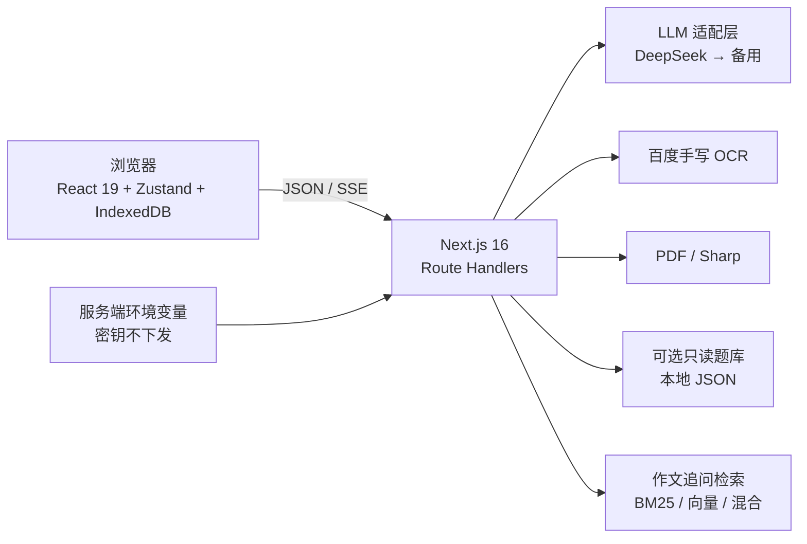

# 考研英语 AI 助手

面向考研英语一 / 英语二的移动优先学习工具：作文批改、长难句分析、真题解析、流式答疑，以及只在浏览器本地保存的历史记录。


> **当前状态**：核心功能已经实现，自动测试、类型检查、lint 与生产构建均通过；但仍处于 1–5 人受邀试用和人工验收阶段。真实手机、原生打印、教师评分校准、真实学生手写、真实备用供应商切换和长期运行可靠性尚未全部签核。**请勿把自动测试通过理解为教学质量或 7×24 服务承诺。**

## 功能

| 模块 | 能力 |
|---|---|
| 作文批改 | 英一 20 分 / 英二 15 分 / 小作文 10 分；先给评分与关键批注，完成即可追问；改进版、范文和表达展开后生成 |
| 作文追问 RAG | 支持 BM25、向量及混合检索，短追问可结合上一条相关提问补足指代，回答中的编号可展开核对教学卡片 |
| 图片 / PDF | 图片 OCR 与扫描 PDF 逐页识别；识别文字可校对；文字 PDF 服务端提取；单文件限制 10MB 图片或 20MB、最多 5 页 PDF |
| 长难句 | 断句、主干、从句、修饰、翻译、语法点、仿写七项结果 |
| 真题解析 | 内置题库（需自行导入）、粘贴文章、PDF 上传；段落精读、定位、干扰项和按需全文翻译 |
| 学习答疑 | SSE 流式输出、多轮上下文、停止与重试 |
| 历史记录 | IndexedDB 本地保存、全文搜索、筛选、删除、JSON 导出/导入 |
| 供应商 | DeepSeek 主供应商，硅基流动 / OpenRouter 可选兜底；密钥只留在服务端 |

查看完整功能与未完成事项：[`docs/STATUS.md`](docs/STATUS.md)。

## 设计边界

- **无登录、无支付、无服务端数据库、无多租户**。
- 学习历史保存在浏览器 IndexedDB，服务端无状态。
- 只有调用 AI / OCR 时，必要文本或图片才会发送给对应供应商。
- 不内置统计、追踪或广告脚本。
- 真题与配图不随代码许可证授权，公开发行包默认不包含这些内容。

## 架构概览



详细设计见 [`docs/ARCHITECTURE.md`](docs/ARCHITECTURE.md)。

在「作文批改 → 继续提问」里，可以追问「He go to school 为什么有语法问题？」或「邀请信结尾怎么礼貌地请对方回复？」。回答采用卡片时会显示可展开的参考来源。首批卡片涵盖常见语法、应用文和图表图画作文，用于练习辅导，目前未经过独立教师审核。配置本地向量检索、复跑对比实验和查看结果，见 [RAG 实验与运行说明](docs/RAG_EXPERIMENTS.md)。

## 快速开始

### 环境要求

- Node.js **>= 22.12**（仓库开发环境为 24.20）
- pnpm **11.25**
- 一个 DeepSeek API Key（核心 AI 功能需要）
- 百度 OCR Key（只有图片/扫描 PDF 功能需要）

### 本地运行

```bash
corepack enable
pnpm install --frozen-lockfile
cp .env.example .env.local
# 编辑 .env.local，至少填写 DEEPSEEK_API_KEY
pnpm dev
```

Windows PowerShell 可用：

```powershell
corepack enable
pnpm install --frozen-lockfile
Copy-Item .env.example .env.local
notepad .env.local
pnpm dev
```

打开 <http://127.0.0.1:3000>。

### 生产构建

```bash
pnpm lint
pnpm typecheck
pnpm test
pnpm build
pnpm start
```

### Docker

```bash
cp .env.example .env.local
# 填入密钥；然后把 deploy/Caddyfile 中的 ky.example.com 改成你的域名
docker compose up -d --build
```

更多说明见 [`docs/DEPLOYMENT.md`](docs/DEPLOYMENT.md) 和 [`deploy/DOCKER.md`](deploy/DOCKER.md)。

## 环境变量

| 变量 | 必填 | 说明 |
|---|---|---|
| `DEEPSEEK_API_KEY` | 是 | 主供应商密钥，只在服务端使用 |
| `DEEPSEEK_BASE_URL` | 否 | 默认 `https://api.deepseek.com` |
| `DEEPSEEK_MODEL` | 否 | 默认 `deepseek-flash`，可按账号可用模型修改 |
| `SILICONFLOW_API_KEY` | 否 | 配置后作为第一备用 |
| `SILICONFLOW_BASE_URL` / `SILICONFLOW_MODEL` | 否 | 硅基流动兼容接口配置 |
| `OPENROUTER_API_KEY` | 否 | 配置后作为第二备用 |
| `OPENROUTER_BASE_URL` / `OPENROUTER_MODEL` | 否 | OpenRouter 兼容接口配置 |
| `LLM_MAX_TOKENS` | 否 | 默认 8000；结构化输出需要足够预算 |
| `ESSAY_RAG_ENABLED` | 否 | 默认启用作文追问检索；设为 `0` 可恢复普通追问 |
| `ESSAY_RAG_MODE` | 否 | `keyword`（默认）、`vector` 或 `hybrid`；后两种需本地 Ollama 和已构建的向量索引 |
| `ESSAY_RAG_REWRITE` | 否 | 默认改写可识别的短追问；设为 `0` 直接检索原查询 |
| `ESSAY_RAG_VECTOR_BACKEND` | 否 | `json`（默认）、`qdrant-exact` 或 `qdrant-hnsw`；Qdrant 模式需先运行 `pnpm rag:qdrant:sync` |
| `BAIDU_OCR_API_KEY` / `BAIDU_OCR_SECRET_KEY` | 否 | 图片与扫描 PDF OCR |
| `RATE_LIMIT_*` | 否 | 内存级 IP 限流参数；`RATE_LIMIT_LLM_DAILY_MAX` / `RATE_LIMIT_OCR_DAILY_MAX` 为滚动 24 小时全站总预算（0 = 不限），防止地址泄露后被轮换 IP 耗尽模型额度 |

完整模板见 [`.env.example`](.env.example)。**不要把 `.env.local`、隧道 Token 或真实密钥提交到 Git。**

## 关于题库

公开源代码发行包默认不附带历年真题、作文题目和配图，原因是这些材料可能受第三方版权保护，MIT 许可证不能覆盖它们。没有题库时：

- 应用仍可构建和启动；
- 作文“其他题目”、长难句、学习答疑、粘贴文章和 PDF 功能可用；
- 题库选择器会显示“暂无内容”并引导使用自由输入。

如需在**本地自用**，将已获授权的数据按 [`docs/DATA.md`](docs/DATA.md) 的目录约定放入：

```text
data/exams/english1/*.json
data/exams/english2/*.json
data/essay-bank/english1/*.json
data/essay-bank/english2/*.json
public/essay-materials/*.jpg
```

这些路径默认被忽略，不应提交到公开仓库。结构检查：

```bash
pnpm data:check
```

## 部署后自检

只读、不消耗模型额度：

```bash
node scripts/verify-deploy.mjs http://127.0.0.1:3000 --readonly
```

干净题库或未配置 OCR 时：

```bash
node scripts/verify-deploy.mjs http://127.0.0.1:3000 --readonly --allow-empty-bank --allow-no-ocr
```

真实调用模型/OCR（会消耗额度）：

```bash
node scripts/verify-deploy.mjs https://your-domain.example
```

## 测试

```bash
pnpm test          # Vitest；没有本地题库时自动跳过完整语料测试
pnpm typecheck
pnpm lint
pnpm build
```

有本地完整题库时，强制运行语料完整性测试：

```powershell
$env:REQUIRE_FULL_CORPUS='1'; pnpm test
```

## 公开部署前

1. 使用干净的公开发行包，而不要直接推送含有真题、图片、个人域名、运行记录和本地配置的工作目录。
2. 生成发行包：

   ```bash
   pnpm release:source
   ```

   默认输出到 `dist/kaoyan-english-assistant-open-source/`，会自动排除题库、配图、个人运维记录、`artifacts/`、`.env*` 和隧道凭据，并生成文件清单与密钥扫描结果。
3. 在全新目录执行 `git init`、首次提交并推送，**不要沿用包含第三方真题历史的旧 Git 仓库**。
4. 公网实例建议放在 Cloudflare Access、基础认证或内网之后。项目本身没有账号系统，IP 限流不能替代访问控制。
5. 配置反向代理时关闭 SSE 缓冲，并确认代理覆盖而不是拼接客户端提供的 IP 头。

完整清单见 [`docs/RELEASING.md`](docs/RELEASING.md)。

## 隐私与安全

- API Key 只从服务端环境变量读取，不进入客户端 bundle。
- 运行日志只记录请求 ID、耗时、供应商、字数与错误码，不记录作文、聊天正文、图片或密钥。
- 历史记录只存浏览器；清除浏览器数据会丢失记录，请先导出 JSON。
- 没有内置身份认证。公开部署后任何拿到地址的人都可以消耗你的模型额度。
- 安全问题请按 [`SECURITY.md`](SECURITY.md) 私下报告，不要公开贴出密钥或学生材料。

## 项目文档

| 文档 | 内容 |
|---|---|
| [`docs/STATUS.md`](docs/STATUS.md) | 现有功能、完成度、已知问题与待办 |
| [`docs/USAGE.md`](docs/USAGE.md) | 用户使用与数据备份说明 |
| [`docs/DEPLOYMENT.md`](docs/DEPLOYMENT.md) | 本机、Docker、Cloudflare、访问控制 |
| [`docs/DATA.md`](docs/DATA.md) | 可选题库目录、结构与版权边界 |
| [`docs/ARCHITECTURE.md`](docs/ARCHITECTURE.md) | 技术架构、数据流与信任边界 |
| [`docs/RELEASING.md`](docs/RELEASING.md) | 开源发行与发布检查 |
| [`CONTRIBUTING.md`](CONTRIBUTING.md) | 贡献流程 |
| [`CHANGELOG.md`](CHANGELOG.md) | 版本变更 |

维护者本地的工作日志、验收证据和真题校对记录不进入公开源代码发行包。

## 许可证

- **源代码**：MIT，见 [`LICENSE`](LICENSE)。
- **真题、题目配图、解析与用户材料**：不属于 MIT 授权范围，见 [`NOTICE.md`](NOTICE.md)。
- **第三方依赖与 PDF worker**：遵循各自许可。
