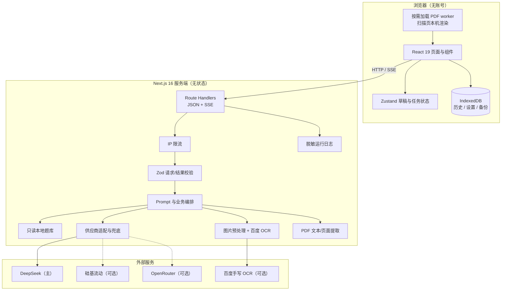
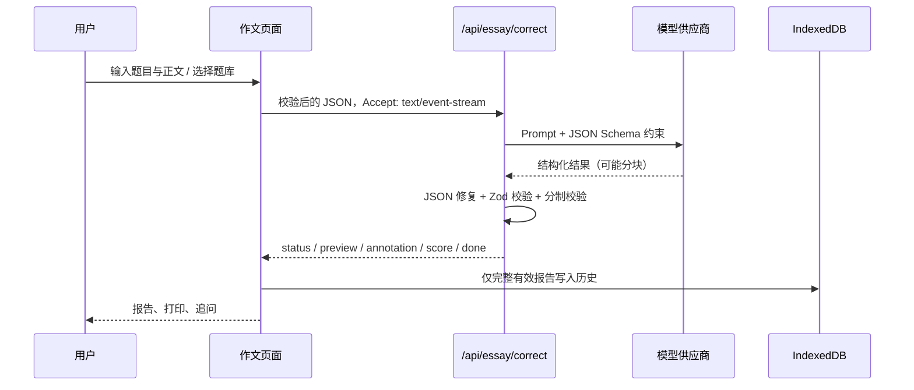
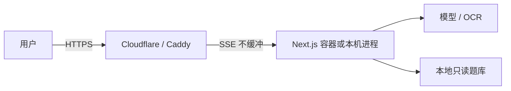

# 架构说明

## 1. 总体结构

## 2. 关键原则

1. **密钥只在服务端**：浏览器 bundle 不读取供应商 Key；所有 AI/OCR 请求经 Route Handler 中转。
2. **服务端无状态**：不保存历史、会话或上传文件；历史只存在用户浏览器。
3. **结果结构可验证**：请求和结果使用 Zod；分数、满分、分项合计和引用关系在服务端与客户端双重校验。
4. **失败不吞结果**：AI 失败保留草稿与已生成文字；完整 Schema 未通过时不展示有效分数。
5. **日志最小化**：只记录请求 ID、耗时、供应商、字数、错误码和格式失败计数，不记录正文、图片、密钥。

## 3. 页面与接口

### 页面

| 路径 | 作用 |
|---|---|
| `/` | 工作台、意图路由、功能入口 |
| `/essay` | 作文题目选择、正文/OCR/PDF、流式批改、追问、打印 |
| `/sentence` | 长难句输入与七项结果 |
| `/exam` | 题库、粘贴、PDF、精读与题目分析 |
| `/chat` | 通用流式聊天 |
| `/history` | 本地历史搜索、筛选、删除、导入导出 |
| `/settings` | 默认题型、字号、供应商状态 |

### API

| 方法 | 路径 | 说明 |
|---|---|---|
| GET | `/api/health` | 健康与配置状态；不返回密钥 |
| POST | `/api/route` | 工作台意图路由 |
| POST | `/api/essay/correct` | 作文批改；默认 JSON，可为 SSE |
| GET | `/api/essay/bank` | 作文题库列表 |
| GET | `/api/essay/bank/[id]` | 作文题目详情 |
| POST | `/api/essay/body` | 作文正文流式生成 |
| POST | `/api/essay/pdf` | 作文 PDF 提取/扫描页渲染/OCR |
| GET | `/api/exam/bank` | 阅读题库列表 |
| GET | `/api/exam/bank/[id]` | 阅读题目详情 |
| POST | `/api/exam/analyze` | 真题解析 |
| POST | `/api/exam/pdf` | 阅读 PDF 文本提取 |
| POST | `/api/chat` | 通用聊天和功能追问（SSE） |
| POST | `/api/ocr` | 手写图片 OCR |
| POST | `/api/sentence/analyze` | 长难句分析 |

## 4. 数据流

### 作文批改

### 扫描 PDF

1. 浏览器校验文件类型和 20MB 上限。
2. 按需加载固定版本 PDF worker。
3. 本机逐页渲染为最长边 2000px、JPEG 质量 80。
4. 每页调用 `/api/ocr`，服务端共用 OCR 节流。
5. 全部页面完成后进入统一校对；任何一页失败都不替换旧草稿。
6. 不上传原扫描 PDF；文字 PDF 仍走服务端提取接口。

## 5. 存储

| 数据 | 位置 | 生命周期 |
|---|---|---|
| 作文、长难句、真题、聊天历史 | IndexedDB `kaoyan-english-assistant` | 用户浏览器；可导出/导入 |
| 设置 | IndexedDB `settings` | 用户浏览器 |
| 题库 | `data/exams`、`data/essay-bank` 只读 JSON | 部署包；公开发行默认不含 |
| 题目配图 | `public/essay-materials` | 部署包；公开发行默认不含 |
| 密钥 | 服务端环境变量 | 部署环境；不写日志、不下发 |

IndexedDB 不可用或事务失败时，应用降级为当前会话内存存储，并明确提示历史不会持久保存。

## 6. 部署边界

- 容器或 Node 进程只监听内网/回环，公网由反向代理接入。
- SSE 必须关闭代理缓冲。
- 没有身份认证；公开实例应由 Cloudflare Access、Basic Auth 或网络 ACL 保护。
- 内存限流只在单进程内有效，多实例部署需要外部限流。

## 7. 失败策略

| 场景 | 行为 |
|---|---|
| 供应商超时 / 429 / 5xx / 空内容 | 按固定顺序尝试已配置备用 |
| JSON 不完整或格式错误 | 确定性修复；仍失败则保留未完成文字反馈，不伪造分数 |
| 已输出部分流式内容后中断 | 不拼接另一个供应商重答，保留部分内容并提示 |
| OCR / PDF 失败 | 友好错误；保留原草稿，可手动输入或重试 |
| IndexedDB 不可用 | 内存会话继续工作，常驻提示 |
| 超出限流 | 429 + `Retry-After`，不调用供应商 |

## 8. 明确未实现

- 登录、账号、权限、支付、订阅。
- 服务端保存用户历史、会话恢复、跨设备同步。
- 模板库 / RAG 检索。
- 自动执行 Agent / Harness / Pi 运行时。
- 深色模式。
