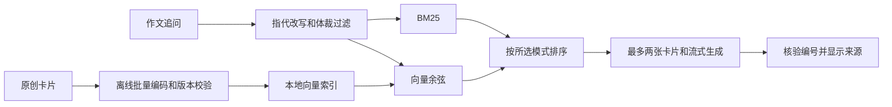

# 作文追问 RAG 实验

作文追问先识别题型和体裁，再检索最多两张相关教学卡片。BM25 负责匹配关键词，本地 Qwen3 向量负责找措辞不同但含义相近的问题，混合模式用倒数排名融合（RRF）合并两路候选。两路都找到了同一张卡片时，该卡片在融合排序中获得两路贡献。

短追问如「换个例句」会带上最近一条有实质内容的用户问题。该改写只影响检索，生成仍收到完整会话。体裁冲突时不检索，向量低于阈值时舍弃。候选排序后保留首张卡片，并筛掉缺少关键词支持、余弦分落后最佳向量超过 0.12 的次要卡片。索引或模型不可用时，向量和混合模式回退到 BM25。生成时沿用现有 SSE，服务端核验引用编号，浏览器可展开对应卡片。作文评分追问沿用原报告分数。



## 运行和复测

```powershell
ollama pull qwen3-embedding:0.6b
pnpm rag:index

$env:RAG_EVAL_SPLIT = 'dev'
pnpm rag:eval
Remove-Item Env:RAG_EVAL_SPLIT
pnpm rag:eval

pnpm rag:eval:answer
```

- `pnpm rag:index` 只编码 `lib/rag/cards.json` 的项目原创卡片。索引默认写到 `artifacts/rag-index.json`，包含卡片 ID、语料哈希、模型摘要、编码格式、维数和距离定义。改动卡片或模型后重建索引并重启应用。
- 开发集校准生成 `artifacts/rag-calibration.json`，保留集生成 `artifacts/rag-retrieval-eval.json`。三种模式和两种改写设置均复用生产检索函数，向量依赖失败时实验报错，避免把回退结果当成向量成绩。
- `pnpm rag:eval:answer` 使用 `.env.local` 配置的第一个生成模型。五条合成问题分别跑无检索、关键词、向量、混合和直接提供正确证据五组，共 25 次生成，结果写到 `artifacts/rag-generation-eval.json`。报告包括生成文本、候选资料、实际引用和延迟。
- 在 `.env.local` 设置 `ESSAY_RAG_MODE=hybrid` 并重启即可启用混合检索。默认是 `keyword`。可用 `ESSAY_RAG_REWRITE=0` 关闭改写，`ESSAY_RAG_ENABLED=0` 关闭检索，`ESSAY_RAG_TRACE=1` 输出延迟、回退状态和卡片 ID。默认 Ollama 访问地址为 `127.0.0.1:11434`，向量服务只接收有界查询和改写所需的上一条用户问题。

14 张卡片的 1024 维索引约 305 KB，可精确遍历并随版本重建。如果语料增长到精确遍历成为延迟瓶颈，可用同一套评测对比向量库的召回与开销。当前模型和编码约定见 [Ollama 模型](https://ollama.com/library/qwen3-embedding:0.6b) 与 [Qwen 模型卡](https://huggingface.co/Qwen/Qwen3-Embedding-0.6B)。

## 保留集结果

同一批卡片、同样的作文体裁约束，统一计算 Top 2。阈值 `0.40` 只用 12 条开发查询校准。保留集含 17 条有相关卡片的查询和 5 条应弃答查询，标签为项目自标。Recall、MRR 和 nDCG 在有答案查询上取宏平均，弃答率单独统计。P95 是本机预热后的检索耗时，包含查询向量化和版本检查。

| 检索 | 改写 | Recall@2 | MRR@2 | nDCG@2 | 正确弃答 | 检索 P95 |
| --- | --- | ---: | ---: | ---: | ---: | ---: |
| BM25 | 关 | 17.6% | 0.176 | 0.176 | 5/5 | 0.23 ms |
| BM25 | 开 | 35.3% | 0.353 | 0.353 | 5/5 | 0.12 ms |
| 向量 | 关 | 82.4% | 0.794 | 0.802 | 5/5 | 46.90 ms |
| 向量 | 开 | 94.1% | 0.941 | 0.941 | 5/5 | 52.51 ms |
| 混合 | 关 | 88.2% | 0.853 | 0.861 | 5/5 | 49.55 ms |
| 混合 | 开 | 100% | 1.000 | 1.000 | 5/5 | 49.34 ms |

改写让混合检索在三条省略式追问中的命中由 1/3 升到 3/3。向量找到了用不同措辞表达的邀请回复、活动安排和语法问题；BM25 则补上了纯向量低于阈值的 `a university / an hour` 冠词题。这里的 BM25 基线沿用产品的关键词门槛，结果适用于这条现有链路和这批问法。样本小且为自标，100% 只描述当前保留集。

查看首轮生成案例后，又用相同保留集做了一次证据筛选的回放对照。混合加改写的上下文卡片总量由 27 张降到 22 张，非空结果的逐题平均精确率从 73.5% 到 88.2%，上下文 Recall@2 仍为 100%。这是观察生成案例后的探索性优化，需在新查询上确认。

## 关键词门槛消融

在同一保留集上开启改写，固定体裁、语料、分词、余弦阈值和候选数。仅在评测中关闭卡片关键词门槛，让 BM25 按词项得分直接参与排序。逐题报告记录查询集哈希、语料哈希和向量模型摘要。

| 检索 | 关键词门槛 | Recall@2 | nDCG@2 | 正确弃答 | 上下文精确率 |
| --- | --- | ---: | ---: | ---: | ---: |
| BM25 | 开 | 35.3% | 0.353 | 5/5 | 100% |
| BM25 | 关 | 73.5% | 0.694 | 1/5 | 35.7% |
| 混合 | 开 | 100% | 1.000 | 5/5 | 88.2% |
| 混合 | 关 | 91.2% | 0.855 | 1/5 | 42.9% |

无门槛的词项匹配扩大了 BM25 召回，也把很多弱相关候选交给 RRF。两路都召回一张卡片时，即使关键词路匹配得很弱，RRF 也会提升其排名。当前产品保留门槛，后续在新的难负例上比较关键词路的置信校准和候选重排。

## 回答与引用

在同一个 `deepseek-flash` 模型上，五组各运行五条合成问题。四条题有相关卡片，一条请求改作文分数，报告给定 8 分。内容检查只核对题目要求的关键点，例如图表题的 15 个百分点和 50% 相对增幅。相关引用覆盖按四条有卡片的问题统计，弃答题单独核对。

| 证据来源 | 内容检查通过 | 至少引用一张相关卡片 | 改分题无引用 |
| --- | ---: | ---: | ---: |
| 无检索 | 5/5 | 0/4 | 1/1 |
| BM25 | 5/5 | 3/4 | 1/1 |
| 向量 | 5/5 | 4/4 | 1/1 |
| 混合 | 5/5 | 4/4 | 1/1 |
| 直接提供标注证据 | 5/5 | 4/4 | 1/1 |

这次生成实验显示的收益是相关引用覆盖，五组的内容检查均通过。模型输出的编号可由服务端核验，整段回答是否充分受资料支撑仍需人工判读。真实生产构建的 `/api/chat` 也实测了改述问题、跨轮指代和体裁冲突三种请求的 SSE 终态。
