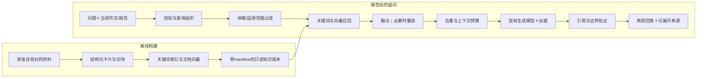

# 考研英语助手：RAG业务与学习路线

更新于 2026-11-06。首个场景为**批改后追问＋表达推荐**。

首版已通过现有 `/api/chat` 的作文追问入口接入。本地 BM25 按作文类别、题面体裁和问题关键词过滤，最多取两张原创卡片。回答沿用 SSE，结束帧附上已匹配的引用编号和资料内容，历史保存在浏览器。未命中时按现有上下文回答。设置 `ESSAY_RAG_ENABLED=0` 可关闭。下文记录后续实验与验收设计。

## 1. 原计划保留什么，修订什么

| 原计划 | 新执行方式 | 理由 |
| --- | --- | --- |
| 后续模板库，检索范文、句型与话题素材 | 第一版只接现有作文报告后的追问，最多推荐2条适用表达 | 用户已明确入口；避免另建页面和增加首次批改耗时 |
| 素材→embedding→余弦Top-K→Prompt | 补齐关键词基线、元数据过滤、引用验证、拒绝不适用材料和分层评测 | 向量相似不等于适用，也不等于事实正确 |
| 向量存文件或IndexedDB | 首期共享知识用服务端只读、可回退的文件索引；用户历史仍在IndexedDB | 统一资料版本，避免每个浏览器重复向量化或缓存不同知识版本 |
| DeepSeek/硅基流动/本地embedding | Generator、Embedder、Reranker三个独立端口与模型配置 | 本项目DeepSeek适配器只实现聊天，不能据此假设有embedding能力 |
| M1验收→M2 Harness→M3 RAG | 旧质量验收继续；并行进行本地RAG学习和独立评测；不启动完整Agent Runtime | 用户现在要求进入RAG；离线实验无需等待教师评分，但不能替代正式质量验收 |
| 推荐“高分模板” | 推荐适用表达及使用条件，不承诺提分 | 防止模板堆砌、语域不合和把例句当通用答案 |

真实 OCR 与评分仍待完整验收。RAG 回归覆盖中英查询、体裁冲突、无关问题和引用验证。卡片和回归样例均为项目原创，后续以独立标注集比较 BM25 与向量召回。

## 2. 为什么引入RAG

当前模型已有英语知识。引入RAG的业务理由是让它使用**我们选择、核对、能定位来源的教学材料**，并使材料更新不依赖重新训练生成模型。

| 用户问题 | 第一版处理 | 检索的作用 |
| --- | --- | --- |
| “这封邀请信怎么表达得更自然？” | 按已选体裁检索邀请与礼貌请求卡片，给1–2条表达和适用位置 | 限定语域与来源，避免推荐公告措辞 |
| “He go为什么不对？” | 原句与报告为当前事实；知识卡解释主谓一致并举例 | 提供有出处的规则解释，不倒推或修改原评分 |
| “换一个环境话题也能用的例子” | 检索话题与功能匹配的卡片 | 控制例句是否适用，显示引用 |
| “我这篇为什么只有8分？” | 先读取本次报告实际理由，再解释相关知识 | 不能仅靠知识库重造阅卷原因，更不能声称教师给了8分 |
| “第二条再举个例子” | 结合本次报告和最近对话消解指代后检索 | 查询组织问题，不能只检索“第二条” |
| “这个建议来自哪条资料？” | 返回本次实际使用的chunk及版本 | 引用可核验，不能事后随便配一个来源 |

RAG不负责修复照片模糊、正文漏页、OCR混入题面、评分标尺不准、服务器退出或公网上传慢；这些仍由各自链路与验收处理。检索也不会天然提高所有回答质量，必须与无检索、关键词方案对照。

## 3. 业务边界与数据

**进入第一版：** 原文问题解释、适用语域、常见错误规则、功能表达及短例句。继续使用现有追问入口，来源默认折叠，正文先给简短回答。

**暂不进入：** 自动重新评分、直接将范文当评分标准、整本教材抓取、学生作文自动入库、跨用户记忆、图像检索、GraphRAG、自主多轮工具循环、多Agent。

首批建议50–100张原创教学卡片，覆盖邀请、请求、建议、道歉、通知、图表描述、图画议论及通用语法。原创演示卡标为原创；AI起草不等于教师审核。教师或其他资料只有在确认使用范围并核对后才能入生产库。现有真题可用作题型/任务元数据，不自动取得范文、教材或第三方批改的入库和公开分发许可。

每张卡至少记录：

```text
documentId / chunkId / version / contentHash
title / text / kind(rule|expression|example)
paperScope / compositionScope / genreScope / topic / communicativeFunction
appliesWhen / doesNotApplyWhen / example
sourceId / locator / sourceType / licenseOrConsent
reviewStatus / reviewer / supersedes / active
```

`chunkId`必须稳定；正文改变形成新版本。`sourceId`应指向可展示的资料记录，不能泄露磁盘绝对路径。`reviewStatus`区分演示、待复核、已核对，不能给模型生成卡片贴“官方/教师权威”标签。

学生作文和报告只是本次请求上下文，默认不写入共享知识库。现有`followUp.dataRef`是浏览器记录ID，不代表服务器能读取那条历史；服务端必须校验本次携带的有界快照，不能把ID当授权凭据。

## 4. 目标流水线



原评分接口不经过这一条链。推荐和解释结果没有更新`scoreCard`的权限。

首版复用 `/api/chat` 的 SSE 协议，在 `done` 事件中增加可选的 `citations`。客户端沿用既有追问记录。服务端只从有效作文快照和最近用户问题提取有界检索输入。检索由 `lib/rag/retriever.ts` 执行，原创卡片位于 `lib/rag/cards.json`，离线 BM25 实验仍可独立运行。

## 5. 逐项拆解技术细节

### 5.1 解析、清洗、切块

第一批用结构化JSON/Markdown卡片，避开扫描资料识别这个额外变量。之后接PDF时分别测PDF解析和检索，不能把OCR错字当知识事实。

一个知识点、使用条件和例句优先构成一个完整块；长资料再按标题/段落切分，保留documentId和位置。可以用100–300 token作为初始实验区间，而不是固定生产标准；短表达不为凑长度拼入无关内容。保留父文档说明，必要时检索小块、补充父级语域条件。overlap只在边界确实丢上下文时使用，不能把大量重复片段塞进Top-K。

验收：切块前后信息完整；条件和例句不分离；来源可追溯；去重；已删除/旧版本不可命中。

### 5.2 Embedding

文本→分词→编码→pooling→可选归一化，得到固定维向量。分词、pooling、前缀和归一化必须遵循具体模型，而不是随意平均token。

文档和查询使用兼容的同一模型、revision和预处理策略；不能把“同为384维”当成同一向量空间。更换模型需要重建文档向量。缓存键包含模型版本、预处理版本和文本hash，不只按文本缓存。

余弦：`cos(q,d) = dot(q,d) / (norm(q) * norm(d))`。已做L2归一化时可直接点积。必须处理空文本、零向量、NaN、维数不一致和超长截断。

中文提问、英文例句需要实测跨语言检索。首个本地候选建议`intfloat/multilingual-e5-small`，官方卡片给出384维、query/passage前缀示例及归一化方式；实际实现使用`query: `和`passage: `，并锁定模型revision。它是待测候选，不保证在本项目胜出。API对照候选可考虑官方支持的多语embedding模型；渠道、数据传输和预算在实际调用前确定，不默认开通硅基流动或改变现有生成供应商。

### 5.3 精确检索与近似索引

首期对归一化向量遍历点积，复杂度约O(Nd)。1万条×384维×4字节约14.65MiB，仅是float32向量，不含文本、模型、进程及索引开销。先量实测P95，再判断是否需要ANN。

HNSW的M、efConstruction、efSearch分别涉及图连接、构建和查询探索；提高探索通常换取更多耗时和召回。要用精确检索作为ANN召回基准。不能因为装了向量数据库就认定检索质量更好。

### 5.4 BM25、混合检索与过滤

BM25擅长明确的语法术语、表达原串；dense检索可补充改写和跨语言匹配。两者都需在本项目测试。中英文混合要明确中文分词、英文词形与标点处理，不能简单对中文按空格分词就称为合格BM25。

先以已确认体裁过滤，通用语法卡可标为any。条件是硬限制时，重排也不能把不适用体裁加回来。主题不一定是硬过滤，以免漏掉跨话题的通用表达。

融合先试RRF：`sum(1 / (c + rank_i))`，缺席的列表贡献0；c可从60开始实验。BM25分和余弦分的量纲不同，不能直接相加假装校准。RRF主要融合排名，也有丢失分差信息的代价。

### 5.5 Reranker

双编码器分别编码q和d，文档可预计算；cross-encoder对每个(q,d)联合打分，通常更慢。先从候选Top-20重排到Top-3的对照实验开始，数字是实验参数，不是定律。必须测额外延迟与增益；如果收益不成立，就不放入第一版。rerank分仍不是“正确概率”。

### 5.6 查询组织与多轮上下文

第一版由最新问题、已确认题型、当前相关批注和最近少量对话构造查询；不把整篇报告不加选择地全部向量化。问题含“第二条/刚才那个”时优先确定指代，无法确定则请求澄清。查询改写是后续独立变量：它会增加模型调用、延迟，也可能改变原意，不能默认每次调用。

精确年份、题型等可信结构字段优先用字段查询；照片里的日期不能直接推断考试年份。

### 5.7 上下文组装、生成与引用

召回Top-K不等于全部放进Prompt。按相关性、互补性和token预算去重，保留使用条件、chunkId与版本。请求事实来自当前作文/报告，外部材料只是辅助证据；正文、检索材料都不能当系统指令。

生成最多2条表达，写清适用位置；没有合适资料就明确“暂无适用资料”。仍可基于当前原文回答已有问题，但要区分“原文分析”与“资料支持”。

引用只允许本次实际检索、有效且可展示的chunkId。先用代码检查ID和版本，再以人工/受控评审检查引用是否真能支撑该断言。存在来源不等于答案被来源支持。流式预览不能在引用尚未验证时把来源标为已核实。

仅用一句“忽略资料中的指令”不足以防提示注入：资料隔离、只读工具、来源白名单、长度限制和输出校验都要落实。

## 6. 逐课实施与退出条件

每课按“原理→最小实现→故意造失败→对照实验→面试复述”进行；先能解释再堆工具。

| 课次 | 实际交付 | 通过条件 | 能回答的面试问题 |
| --- | --- | --- | --- |
| R0 边界与数学 | 本路线；二维手工向量实验 | 手算排名；解释相似度为什么会选错体裁 | RAG、微调、长上下文、Agent分别解决什么 |
| R1 数据与关键词基线 | 50–100张卡的schema；先核对10张；混合语言BM25 | 来源与使用条件齐全；固定查询可复现；先有无RAG/关键词基线 | 数据从哪来，如何切块和避免泄漏 |
| R2 真向量 | 一个真实Embedder适配器；文档批处理与查询编码 | 前缀/维数/归一化/超长/版本都可验证；CPU延迟有实测 | 为什么不能混用embedding；模型与数据库区别 |
| R3 精确检索与混合 | exact cosine；metadata过滤；BM25+dense RRF | 在同一查询集上报告Recall@5/MRR/nDCG；保留失败例 | dense为何可能输给BM25；过滤与融合怎么做 |
| R4 最小生成闭环 | coach Prompt；证据结构；来源显示；无结果分支 | 只用允许的来源；原评分不变；不适用材料不能强推 | 如何处理幻觉和引用“看似正确” |
| R5 进一步优化 | rerank、指代消解、chunk大小与K的单变量实验 | 在相关性、延迟、成本上有可解释增益才保留 | reranker与embedding区别；慢在哪里 |
| R6 产品与部署 | 只读索引版本、开关、健康、回滚、元数据trace | RAG故障不影响首次评分；关开关可回原追问 | 索引如何增量更新，模型变更如何迁移 |
| R7 求职演示 | 可复现实验包、错误案例、架构、演示与复盘 | 用实测结果解释取舍；不编造提升率或生产规模 | 从业务失败到诊断、修复、验证的完整闭环 |
| R8 可选Agent化 | retrieval作为一个只读工具的受限循环 | 只有固定流程确实不足才试；限定调用次数/取消/预算 | 固定RAG与Agentic RAG边界，Harness提供什么 |

预计按8–12次学习与实现会话推进，取决于标注和实测；这不是自动后台计划或交付日期承诺。R1只先做10条卡、12条查询的小批，核对契约后再扩充，避免一次做100条后返工。

R0已提供：`learning/rag/01-retrieval.mjs`和同目录README。它用手工向量演示检索原理，不是已训练模型或真实RAG效果。后续每课各自留一份实验记录，不一次替用户完成全部作业。

R1教学版已提供：[第二课](../learning/rag/02-knowledge-and-bm25.md)。首批10卡、12条开发查询、真实BM25词项统计与9项测试已运行。默认10/11有答案查询首位命中；英文改写Q11保留为下一阶段对照失败。演示材料和标签未独立复核，生产审核与后续扩展目标仍保留。下一课用同一数据进入R2真实embedding，不以追加失败问句到知识卡的方式冒充泛化改进。

## 7. 测评设计

新建60条查询作为目标：规则解释20、表达推荐24、多轮指代8、无结果/不适用8。按查询模板/同义改写/同一原文分组，建议开发30、固定回归15、封存15；分组不齐时记录实际数量，不强拆。语料库版本冻结。

**知识库文档可被不同查询集合检索，这是RAG正常设置。** 要隔离的是评测问题、答案标签和近重复查询，不是把测试题所需资料从索引删掉。黄金问答、教师盲评答案及测试作文不混入资料库；知识卡片与评测标签分开维护。

每条查询记录相关chunk集合、分级相关性、适用体裁、必须保留的事实、禁止推荐的材料、是否应无结果、标注/复核状态。自动生成的查询可以帮助扩充，但未经独立核对不算黄金标签。

对照组：A0无检索、A1 BM25、A2 dense、A3 hybrid、A4 hybrid+rerank、A5人工提供正确证据（oracle）。生成模型与参数保持一致；按相同查询重复试次并报告分组结果。

| 层面 | 主要指标 | 诊断意义 |
| --- | --- | --- |
| 召回 | Recall@5、错误体裁命中率 | 合适资料是否进候选 |
| 排名 | MRR、nDCG@5 | 好资料是否排在前面；不能只看top1相似度 |
| 引用 | ID有效率；断言被引文支持的比例 | 来源存在与内容支持分开统计 |
| 回答 | 必需知识点、主要错误解释、适用性与教师复核 | 检索到不等于回答对 |
| 无结果 | 正确不推荐/澄清率、误拒率、回答覆盖率 | 不把“全部拒绝”当安全满分 |
| 工程 | 索引加载、query embedding、召回、重排、TTFT/总耗时P50/P95；成本/调用数 | 质量与慢的来源分开 |

初始拟定门槛：有答案查询Recall@5≥85%、被引用ID有效率100%、断言支持率≥95%、适用性人工通过≥90%、无结果行为正确≥90%、评分变更0；检索阶段P95先以≤1秒为实验目标，不含生成。这些是待验证的本项目目标，不是行业标准；小样本须同时展示分子/分母，尚未测得不能填“通过”。阈值只在开发集调，封存集不反复调到过。

无RAG与oracle都错：先看生成/问题定义；oracle对而检索版错：先看召回、排序、上下文组装；无RAG对但RAG错：查错误知识与不适用材料。评分差异仍需另一套真实教师标准，RAG指标不替代它。

评审模型可辅助打标，但需核对人工一致性；同一个模型既生成又评审有偏差。借鉴Ragas的检索/忠实度/回答拆分，不必第一天安装评测平台或建设完整Harness。

## 8. 部署路线

### 本机学习与受邀试用

1. R1阶段仅Node CLI＋只读知识文件，不需要服务器、GPU或数据库。
2. R2先测试本地小型多语模型。当前机器约15.2GiB内存、Ryzen 7 6800H，可作为实验起点；CPU常驻内存、冷启动、并发和延迟必须实测，不承诺能承受公开流量。生成继续用现有DeepSeek。
3. 选本地模型时，用独立`Embedder`服务/适配器，Python侧进程只监听回环地址；也可比较Node ONNX方案，选择后锁定依赖与模型revision。模型不放`public/`；不在每次请求下载或重建索引。
4. Next.js继续承担查询、过滤、索引搜索和答案生成，知识版本随新候选部署。只把Next.js经既有隧道公开；embedding服务和资料文件不额外暴露。
5. 如选API embedding，改成显式配置的独立Embedder；先验证账号模型可用、数据传输范围及单次/日预算，保留生成模型现有顺序。云API也要测网络P95和失败降级。
6. 候选先本机验证，RAG开关初始关闭；隔离的受邀实验通过后再按发布器切换。embedding或检索失败时可回退关键词或仅基于原文分析，明确不提供检索资料引用。不得悄悄用另一embedding模型去搜索旧向量。

### 需要24小时服务时

到那时再评估Linux主机/容器：Next.js＋只读索引；本地encoder侧车或API任选一种。数据量、在线编辑、删除权限、并发或多实例一致性确有需求后，再讨论PostgreSQL＋pgvector。引入数据库是新持久化范围，不能在本轮悄悄落地。

pgvector支持精确与近似搜索；小规模并非必须先建HNSW。近似索引结合过滤可能返回不足K，需要测过采样、迭代扫描或分区，不能把空结果误诊为知识库没内容。

索引manifest包括语料/切块/embedding版本、维数、距离与归一化策略、chunk数、hash与构建时间。新版本离线生成、校验、候选加载预热后原子切换，保留旧版本；删除条目立即从active集合排除，向量物理清理另行执行。索引更新和代码发布可以分开，但必须兼容性验证。

未来日志记录requestId、corpusVersion、embedModel、候选chunkId/排名、阶段耗时、token/费用（未知就是未知），不记录学生正文、完整问题、密钥或大段检索内容。完整回放先使用获准保存的离线演示数据。

## 9. 求职材料与后续步骤

项目讲解按“需求→基线→失败→改动→评测→部署取舍”组织。能现场解释过滤为什么修正一个错误命中，通常比罗列LangChain/向量库名字更有说服力；岗位要求仍需逐份JD核对。

简历只写实际完成的组件和数据。例如“对照BM25、dense、hybrid并记录Recall@5与P95”要等真实实验完成；现在只能写完成业务设计和离线数学实验。RAG固定流水线不是自主Agent；等R7之后再根据实际需要讨论检索工具循环与Harness。

紧接着的实现：运行R0实验、手算一次；随后一起确定10条原创卡片的字段与12条查询标签，完成R1关键词基线。生产资料审核、模型渠道与预算在R1/R2落地前确认，不一次安装全套框架。

## 资料依据

- [RAG原论文](https://arxiv.org/abs/2005.11401)：参数知识与外部检索记忆的组合。
- [RRF原论文记录](https://ir.webis.de/anthology/publications/rec%2Bconf%2Bsigir%2BCormackCB09)：排名融合。
- [E5作者模型卡](https://huggingface.co/intfloat/multilingual-e5-small)：前缀、pooling、归一化与限制，实施前锁定revision。
- [硅基流动Embedding API](https://docs.siliconflow.cn/docs/api/embeddings-post)、[Rerank API](https://docs.siliconflow.cn/docs/api/rerank-post)：能力独立，不默认实际开通。
- [pgvector官方文档](https://github.com/pgvector/pgvector)：精确/近似检索、距离、过滤与索引。
- [Ragas论文](https://arxiv.org/abs/2309.15217)：分开检查检索、忠实度与生成；不是本项目人工验收的替代品。

以上是研究/产品资料，未证明本项目RAG已有任何提升。已完成与规划部分必须分开陈述。
